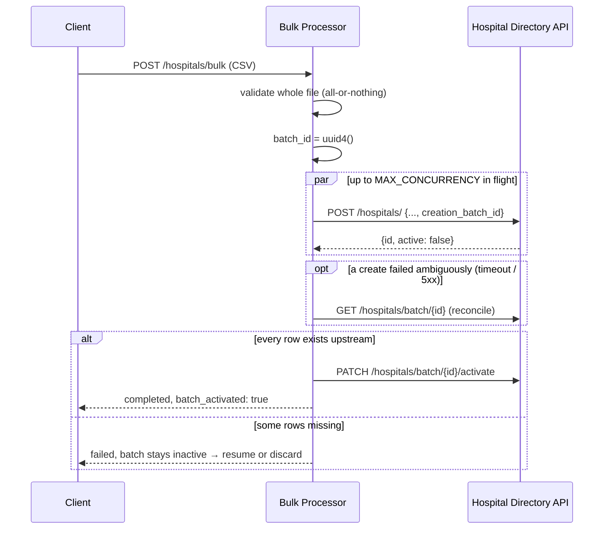

# Hospital Bulk Processor

A FastAPI service that bulk-creates hospitals from a CSV through the
[Hospital Directory API](https://hospital-directory.onrender.com/docs). It sends rows concurrently and activates
the batch only when every row was created. It also offers progress polling, resume, discard and a validation
endpoint.

- **Live:** <RENDER_URL> (interactive docs at `/docs`)
- **Stack:** Python 3.12 · FastAPI · httpx (async) · pytest · Docker · Render

## Quick start

```bash
BASE=<RENDER_URL>        # or http://localhost:8000

# Create a batch and wait for the result
curl -F file=@samples/hospitals.csv $BASE/hospitals/bulk

# Fire-and-poll
curl -i -F file=@samples/hospitals.csv "$BASE/hospitals/bulk?wait=false"   # 202 + Location
curl $BASE/hospitals/bulk/<batch_id>

# Validate only (no upstream calls)
curl -F file=@samples/invalid.csv $BASE/hospitals/bulk/validate
```

CSV format: a header row (any column order, case-insensitive) with `name,address` and an optional `phone`,
followed by at most 20 rows.

`phone` is validated, permissively. Digits, spaces, `+ ( ) . -` and an optional `x`/`ext` suffix are accepted,
with at least 3 digits. A value such as `N/A` rejects the file with a clear row error, because the whole file is
validated before anything is created.

```csv
name,address,phone
General Hospital,123 Main St,555-1234
"Mercy Clinic, North Wing","789 Pine Rd, Suite 5",
```

Response, matching the spec's shape with `status` and `error` added:

```json
{
  "batch_id": "09ac3087-ad70-4099-bb2b-9ae7f40d2271",
  "status": "completed",
  "total_hospitals": 4,
  "processed_hospitals": 4,
  "failed_hospitals": 0,
  "processing_time_seconds": 6.052,
  "batch_activated": true,
  "error": null,
  "hospitals": [
    {"row": 1, "hospital_id": 2645, "name": "General Hospital", "status": "created_and_activated", "error": null}
  ]
}
```

## API

| Method | Path | Purpose |
|---|---|---|
| `POST` | `/hospitals/bulk?wait=true` | Upload a CSV and process it. `200` with the final result; `?wait=false` returns `202` plus a `Location` header to poll. `422` if the CSV is invalid (nothing is sent upstream), `413` if the file is too large. |
| `POST` | `/hospitals/bulk/validate` | Validate a CSV without processing it. Returns per-row errors. |
| `GET` | `/hospitals/bulk/{batch_id}` | Live status and progress of a batch, in the same shape as the result. |
| `POST` | `/hospitals/bulk/{batch_id}/resume` | Retry a `failed` batch under the same batch id. Only missing rows are re-created, then the batch is activated. `409` if the batch is not failed. |
| `DELETE` | `/hospitals/bulk/{batch_id}` | Discard a `failed` (still inactive) batch upstream. `409` otherwise. |
| `GET` | `/health` | Liveness check. |

Batch `status` is one of `processing`, `completed`, `failed` (resumable) or `discarded`.
Row `status` is one of `pending`, `created` (exists upstream but inactive), `created_and_activated`, `failed` or `discarded`.

## How it works



### Design decisions

1. **Concurrent fan-out is the main performance lever.** A single upstream create takes about 5s,
   and upstream handles parallel requests well. Rows go out together through one pooled `httpx.AsyncClient`, capped by a
   **process-wide** semaphore, so several simultaneous uploads together can never exceed `MAX_CONCURRENCY` upstream calls.
   This is also why the service uses FastAPI rather than Flask: async I/O fan-out is native, and the OpenAPI docs come for free.

2. **The batch goes live all-or-nothing.** Upstream keeps hospitals inactive until their batch is activated,
   so the batch works as a staging area. The service activates it only when every row exists, which means
   readers never see half a CSV. A partial failure leaves the batch inactive, and it can be resumed or discarded.

3. **Retries never duplicate or misreport.** Probing the live API showed that neither upstream write is idempotent:
   - `POST /hospitals/` has no idempotency key, so a blind retry after a timeout can create the same hospital twice.
   - Re-sending `PATCH …/activate` to a batch that is already active returns `400`.

   The retry policy follows from that:
   - `POST` and `PATCH` are retried only when the request provably never reached the app (connect failure,
     `429`, `503`).
   - Ambiguous failures (read timeout, `500`/`502`/`504`) are not retried. The service checks
     `GET /hospitals/batch/{id}` instead:
     - rows that actually landed are recovered, and any duplicates are deleted;
     - a `PATCH` whose response was lost still counts as success if every row is active.
   - `GET` and `DELETE` are retried on any transient error, with exponential backoff and jitter.

   Reconciliation matches rows on `(name, address)`. The validator guarantees this pair is unique within a file.

4. **Resume re-runs the same pipeline.** Each run reconciles with upstream, creates whatever is missing, then
   activates. Because ambiguous outcomes are checked against upstream, the pipeline is safe to re-run, so resume
   needs no separate code path. If only activation failed, resume re-sends just the `PATCH`. If that activation
   had in fact been applied, upstream's `400` is checked and treated as success.

5. **Validation is all-or-nothing, before any network call.** One pure function, shared by `/bulk` and
   `/bulk/validate`, checks:
   - encoding (UTF-8, BOM tolerated), the header, required fields and the row limit;
   - phone format (permissive) and duplicate rows.

   An invalid file returns every error at once and creates nothing upstream.

6. **The server waits by default, and polling is optional.** With the 20-row cap, a synchronous call finishes
   in about 6s, which matches the response shape in the spec. `?wait=false` returns `202` at once for clients
   that prefer polling. Processing is wrapped in `asyncio.shield`, so a client disconnect cannot abandon a
   half-created batch.

### Performance, measured against the live upstream (20-row CSV)

| Mode | Processing time |
|---|---|
| Sequential (`MAX_CONCURRENCY=1`) | 105.5 s |
| Concurrent (default, `MAX_CONCURRENCY=20`) | **6.1 s** (≈17× faster) |

### Failure behaviour

| Scenario | Result |
|---|---|
| Invalid CSV | `422` listing every error; no upstream calls |
| Upstream unreachable or `503` on create | Retried with backoff (3 attempts) |
| Read timeout or `500` on create | Not retried. Reconciled with upstream, then the row is either recovered or marked `failed` |
| Upstream `4xx` on create | Row marked `failed`, with the upstream message |
| Any row failed | `status: failed`, batch not activated, existing rows remain inactive. Resume or discard. |
| Activation unreachable or `503` | Retried with backoff |
| Activation timed out or `5xx` | Not retried. The batch listing decides: if every row is active, `completed`; otherwise `failed`, and resume retries only the activation |

## Run it

```bash
python3.12 -m venv .venv && .venv/bin/pip install -r requirements-dev.txt
.venv/bin/uvicorn app.main:app --reload            # http://localhost:8000/docs

docker compose up --build                          # same thing, containerised
```

### Tests

```bash
.venv/bin/pytest                                   # 40 tests, ~1.5s, no network
RUN_LIVE_TESTS=1 .venv/bin/pytest tests/test_live_upstream.py   # real upstream; deletes its own batch
```

- `tests/test_csv_parser.py` covers validator edge cases: BOM, quoting, the 20-vs-21 row boundary,
  duplicates, phone formats and encoding.
- `tests/test_bulk_api.py` exercises the full API against an in-memory fake upstream (`httpx.MockTransport`)
  with fault injection. It covers:
  - partial and total failure, bounded and safe retries, and an ambiguous timeout that must not create a duplicate;
  - an activation that applied but lost its response, which must be reported live;
  - resume, duplicate removal, async polling, discard, and the concurrency limit.

  The fake reproduces live upstream quirks: `404` for an empty batch and `400` on re-activation.
- Mutation-checked: each core guarantee was deliberately broken in turn, and the matching test went red. The
  broken guarantees were:
  - activating despite failures, blind `POST` retry, skipping duplicate deletion;
  - dropping the concurrency cap, sequential creates, and resume without reconcile.

### Configuration (environment variables)

| Variable | Default | Notes |
|---|---|---|
| `UPSTREAM_BASE_URL` | `https://hospital-directory.onrender.com` | |
| `MAX_CONCURRENCY` | `20` | Process-wide cap on in-flight upstream calls |
| `UPSTREAM_TIMEOUT_SECONDS` | `60` | Leaves headroom for Render cold starts |
| `MAX_ATTEMPTS` / `RETRY_BACKOFF_SECONDS` | `3` / `0.5` | Exponential backoff with jitter |
| `MAX_CSV_ROWS` / `MAX_UPLOAD_BYTES` | `20` / `1000000` | |
| `MAX_JOBS_IN_MEMORY` | `1000` | Oldest jobs are evicted beyond this |

## Deploy (Render)

`render.yaml` is a Blueprint for the same Docker image. In Render, choose **New → Blueprint**, select this
repository, and apply. The health check is `/health`. Render injects `$PORT`, which the container honours.

## Limits and next steps

- **Job state is in memory**, so the service runs as a single worker; asyncio provides the concurrency.
  A restart, or a spin-down on Render's free tier, forgets past jobs: their status and resume endpoints then
  return `404`. Hospitals already created upstream are unaffected. Scaling out would need two changes:
  - move `JobStore` (which only does `add`/`get`) to Redis with a TTL;
  - process jobs from a queue so that work survives restarts.
- An `Idempotency-Key` header on `POST /hospitals/bulk` would make client-side retries of the upload itself safe.
- Server-Sent Events or WebSocket progress could be layered over the existing job state. Today, polling covers it.
- There is no auth or rate limiting. Both belong at the gateway before exposing this publicly.

## Layout

```text
app/
  main.py         FastAPI app factory and routes
  csv_parser.py   pure CSV validation (shared by /bulk and /bulk/validate)
  processor.py    workflow: concurrent create → reconcile → activate; resume and discard
  upstream.py     Hospital Directory client: pooling, global concurrency cap, idempotency-aware retries
  jobs.py         job/row state and the in-memory store
  schemas.py      response models
  config.py       env-driven settings
tests/            fake upstream (conftest.py), parser tests, API tests, opt-in live test
```
